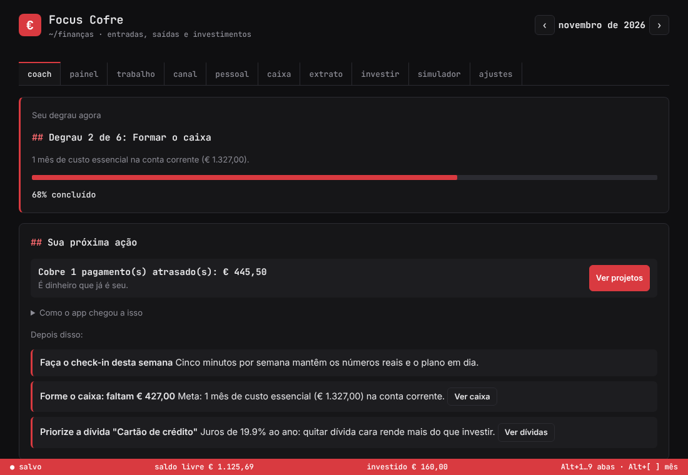
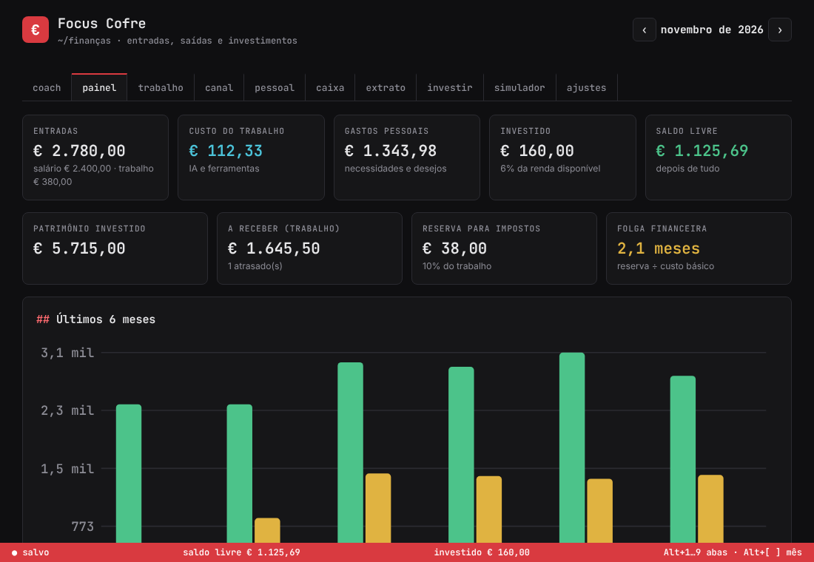
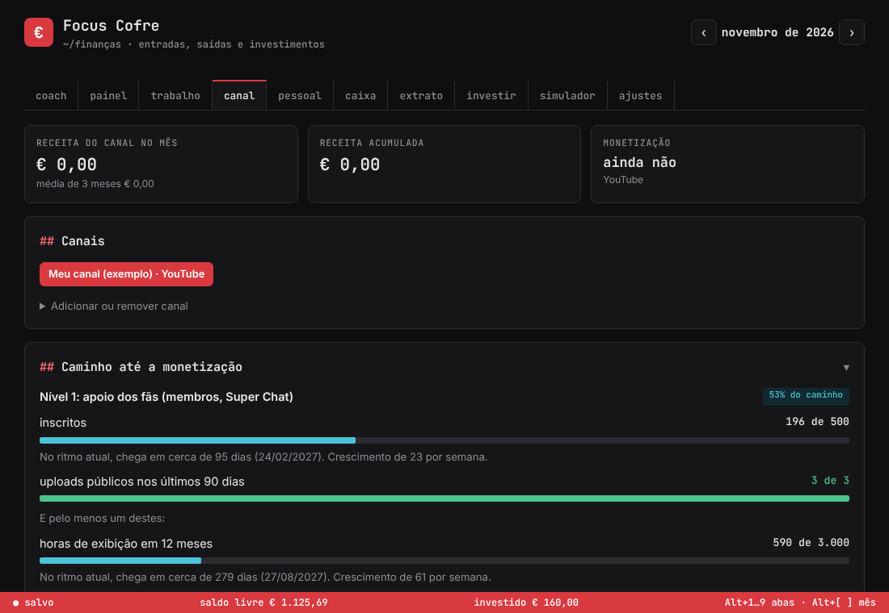
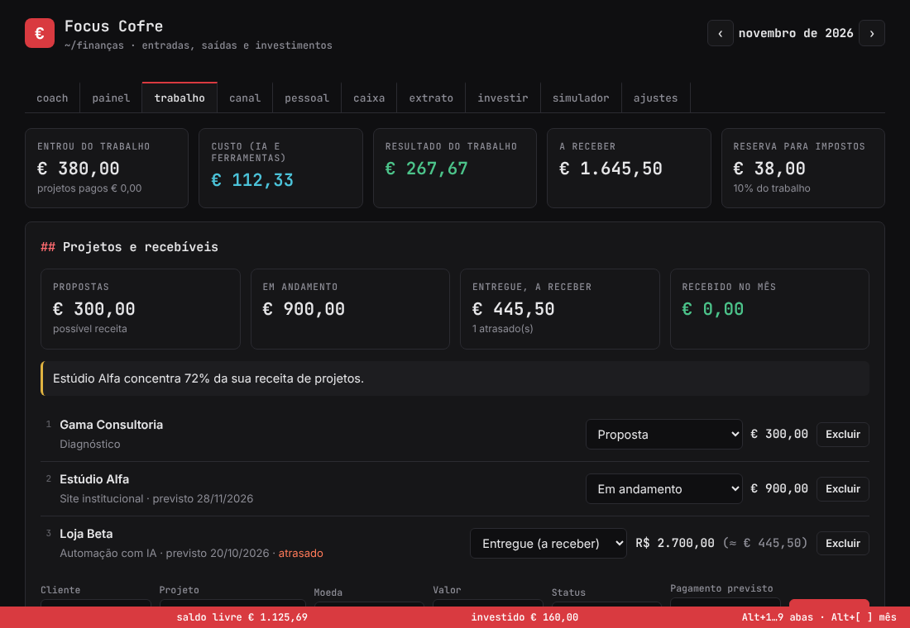
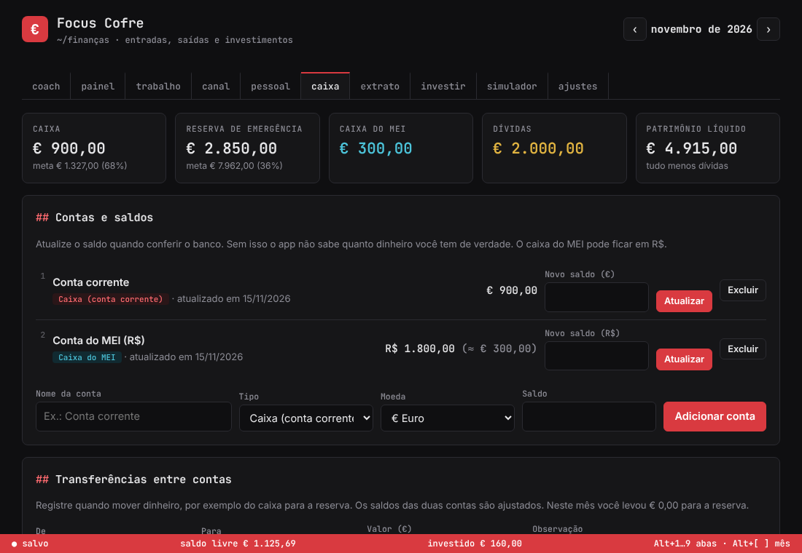

# Focus Cofre

🌐 [English](README.md) · [Português (BR)](README.pt-BR.md) · **Español**

**Un *coach* de finanzas personales local-first, en euros y multimoneda.** Registra ingresos y gastos, separa el dinero
del trabajo del personal, construye un plan por pasos (colchón de caja → deudas → fondo de emergencia → invertir →
ingresos extra) y conversa contigo sobre tus propias cifras, sin enviar tus datos a la nube.



> Proyecto personal construido desde cero: ingeniería de software, modelado del dominio financiero, seguridad de un
> servidor local e integración de un LLM con herramientas. El código, las decisiones y los límites están documentados en
> [`docs/es/`](docs/es/). Documentación completa en tres idiomas: [English](docs/en/) · [Português](docs/pt-BR/) · [Español](docs/es/).

## Por qué existe

La mayoría de las apps de finanzas son hojas de cálculo bonitas: muestran el pasado y te dejan la decisión a ti.
Focus Cofre intenta responder a la pregunta que importa: **«¿qué hago con mi dinero este mes?»**

El perfil de uso que guio el diseño: una persona empleada en España (ingresos en euros), con ingresos extra de una
microempresa individual brasileña (MEI, en reales), una deuda por saldar, un fondo de emergencia por formar y un canal
de contenido que aún no está monetizado. De ahí salieron requisitos reales: varias monedas, impuestos de dos países e
ingresos irregulares.

## Qué hace

| Área | Qué incluye |
|---|---|
| **Coach** | Diagnóstico inicial, 6 pasos con progreso, próxima acción con explicación («cómo llegó la app a esto»), plan del mes («págate primero»), calendario de 14 días, detección de hábitos y anomalías, nota de salud financiera, revisión semanal, evolución del patrimonio, previsión de caja a 6 meses, plazos, simulador «¿y si…?» |
| **Coach con IA** | Conversación con Claude. La IA usa **10 herramientas locales** (los cálculos de la propia app) en lugar de inventar cifras. Solo salen del ordenador totales y medias, nunca nombres ni descripciones |
| **Trabajo** | Proyectos y cobros pendientes (propuestas, retrasos, concentración de clientes), precio mínimo por hora, retorno de las herramientas de IA, reserva para impuestos, tope anual del MEI |
| **Canal** | YouTube, Twitch y otras: camino hacia la monetización con **fecha estimada por regresión lineal**, métricas semanales, ingresos, simulador, lista de comprobación |
| **Caja** | Cuentas con saldo estimado, transferencias, deudas (método avalancha), metas, restauración de copias de seguridad |
| **Extracto** | Movimientos editables y recurrentes, **importación de CSV bancario** (importe único o columnas de cargo/abono, moneda, cuenta, columna de saldo, categoría sugerida) |
| **Invertir** | Plan de aportaciones por perfil, cartera, productos e impuesto sobre ganancias para España |

|  |  |
|---|---|
|  |  |
|  |  |

## Aspectos técnicos destacados

- **Local-first.** Los datos viven en un archivo SQLite en el ordenador del usuario. Sin cuenta, sin servidor, sin telemetría.
- **Dinero en céntimos enteros** en la base de datos; varias monedas con el **tipo de cambio guardado por transacción** (cambiar el tipo hoy no reescribe el pasado).
- **Un motor financiero verificable.** Reglas de negocio puras cubiertas por pruebas de comportamiento. Véase [`docs/es/MOTOR-FINANCIERO.md`](docs/es/MOTOR-FINANCIERO.md).
- **Un LLM con frontera de privacidad.** La clave de la API solo está en el servidor local (el navegador nunca la ve). La IA responde mediante **uso de herramientas**: cada cifra sale de una herramienta ejecutada en el navegador. Las llamadas usan el SDK oficial y los bloques de razonamiento se devuelven intactos.
- **Seguridad del servidor local.** Escucha solo en `127.0.0.1`, token por sesión, validación de la cabecera `Host`, protección frente a *path traversal* y validación estricta de la entrada. Véase [`docs/es/SEGURIDAD-Y-PRIVACIDAD.md`](docs/es/SEGURIDAD-Y-PRIVACIDAD.md).
- **Base de datos con migraciones y restauración.** Esquema versionado (v7), migraciones automáticas, copia diaria y restauración con copia de seguridad previa.
- **Sin framework en el front-end y sin paso de compilación:** módulos de JavaScript sencillos y fáciles de leer.
- **Distribución para Windows sin Windows.** Un script monta una carpeta portátil (lanzador en Go + Python incluido + bibliotecas nativas) desde Linux. Véase [`docs/es/DECISIONES.md`](docs/es/DECISIONES.md).
- **Pruebas por capas:** unitarias, de integración contra un **servidor falso de la API de Claude** y de extremo a extremo en un navegador real.

## Cómo ejecutarlo

### Windows (versión portátil)
1. Descarga `FocusCofre-Windows.zip` (lo genera el flujo `portatil-windows` o `python tools/montar_windows.py`).
2. Extrae la carpeta completa y abre `FocusCofre.exe`. Usa el Edge o Chrome ya instalados.
3. Windows puede mostrar el aviso de SmartScreen porque el programa no tiene firma digital de pago.

### Desarrollo (cualquier sistema)
```bash
pip install -r requirements.txt     # anthropic (y pywebview/pyinstaller para empaquetar)
python app.py --browser             # se abre en el navegador; usa --janela para una ventana de aplicación de Edge/Chrome
```
Datos: `%APPDATA%\FocusCofre\cofre.db` en Windows, `~/.local/share/focuscofre/cofre.db` en Linux.

### Generar el ejecutable
- **Portátil (recomendado, funciona desde Linux):** `python tools/montar_windows.py` (requiere Go, curl y pip).
- **Archivo único con PyInstaller (en Windows):** `build.bat`.

### Coach con IA (opcional)
En **ajustes**, pega tu clave de la API de Anthropic y elige el modelo. Sin clave, todo sigue funcionando con reglas locales.

## Pruebas

```bash
python -m unittest discover -s tests            # 26 pruebas: base de datos, migraciones, API, restauración, puente con la IA
node tests/logic.test.js                        # 32 comprobaciones de la lógica financiera (requiere playwright)
python tests/e2e/rodar_llm.py                   # conversación con el coach, de extremo a extremo
python tests/e2e/rodar_llm.py tests/e2e/fluxos.js   # extracto, canal, monedas y copia de seguridad, de extremo a extremo
```
Más en [`docs/es/PRUEBAS.md`](docs/es/PRUEBAS.md).

## Estructura

```
app.py            servidor local (127.0.0.1) + ventana + ciclo de vida
db.py             SQLite: validación, migraciones, copia de seguridad y restauración
llm.py            puente con la API de Claude (SDK oficial)
web/              interfaz (HTML + CSS + módulos de JavaScript)
tools/            bundle.py (archivo único) y montar_windows.py (paquete portátil)
windows/          lanzador en Go
tests/            pruebas en Python, Node y de extremo a extremo
docs/             arquitectura, motor financiero, decisiones, seguridad y pruebas (en, pt-BR, es)
```
Unas 2.700 líneas de código de producción (Python ~900, JavaScript ~1.700) y ~650 líneas de pruebas.

## Documentación

- [Arquitectura](docs/es/ARQUITECTURA.md) · [Motor financiero](docs/es/MOTOR-FINANCIERO.md) · [Decisiones de diseño](docs/es/DECISIONES.md)
- [Seguridad y privacidad](docs/es/SEGURIDAD-Y-PRIVACIDAD.md) · [Pruebas](docs/es/PRUEBAS.md) · [Registro de cambios](CHANGELOG.md) · [Cómo contribuir](CONTRIBUTING.md)

## Estado y límites (sin adornos)

- Probado: unitarias, integración, extremo a extremo en navegador (Chromium) y en anchuras de móvil.
- **Aún sin probar:** la ejecución real del paquete en Windows y una llamada real a la API de Claude (probada contra un servidor falso que comprueba el formato exacto de la petición).
- La app **calcula y organiza**; no es asesoramiento financiero ni fiscal. Los tipos impositivos y los requisitos de las plataformas cambian y están marcados como referencia.
- Las hipótesis del perfil de uso (España, MEI brasileño) se configuran en **ajustes**, pero algunos textos todavía asumen ese perfil.
- La **interfaz de la app está en portugués de Brasil**. La documentación es trilingüe; traducir la interfaz (i18n) está en la hoja de ruta.

## Licencia

[MIT](LICENSE).
