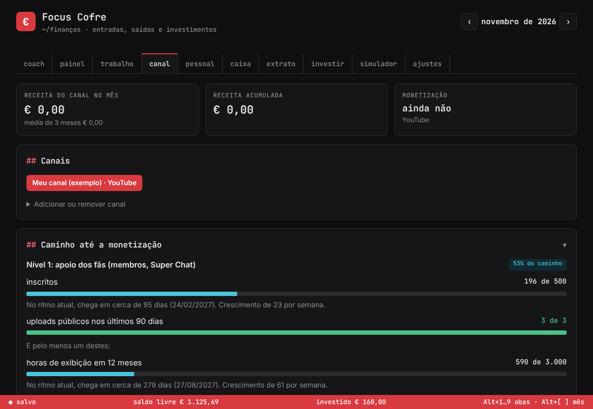

# Focus Cofre

🌐 **English** · [Português (BR)](README.pt-BR.md) · [Español](README.es.md)

**A local-first personal finance *coach*, EUR-based and multi-currency.** It records income and expenses, separates
work money from personal money, builds a step-by-step plan (cash buffer → debt → emergency fund → investing → extra
income) and talks to you about your own numbers, without sending your data to the cloud.


> A personal project built from scratch: software engineering, financial-domain modelling, local-server security and
> LLM integration with tools. Code, decisions and limits are documented in [`docs/en/`](docs/en/).
> Full documentation in three languages: [English](docs/en/) · [Português](docs/pt-BR/) · [Español](docs/es/).

## Why it exists

Most finance apps are good-looking spreadsheets: they show the past and leave the decision to you.
Focus Cofre tries to answer the question that matters: **"what should I do with my money this month?"**

The usage profile that shaped the design: someone employed in Spain (income in euros) with side income from a Brazilian
sole-proprietor company (MEI, in reais), a debt to pay off, an emergency fund to build, and a content channel that is
not monetized yet. That produced real requirements: several currencies, taxes in two countries and irregular income.

## What it does

| Area | What is in it |
|---|---|
| **Coach** | Initial diagnosis, 6 steps with progress, next action with an explanation ("how the app got there"), monthly plan ("pay yourself first"), 14-day calendar, habit and anomaly detection, financial health score, weekly check-in, net-worth evolution, 6-month cash forecast, deadlines, "what if…?" simulator |
| **AI coach** | Chat with Claude. The AI uses **10 local tools** (the app's own calculations) instead of making numbers up. Only totals and averages leave the computer, never names or descriptions |
| **Work** | Projects and receivables (proposals, late payments, client concentration), minimum hourly rate, return on AI tools, tax reserve, MEI annual cap |
| **Channel** | YouTube, Twitch and others: path to monetization with an **estimated date from linear regression**, weekly metrics, revenue, simulator, checklist |
| **Cash** | Accounts with estimated balance, transfers, debts (avalanche method), goals, backup restore |
| **Statement** | Editable and recurring entries, **bank CSV import** (single amount or debit/credit columns, currency, account, balance column, suggested category) |
| **Invest** | Contribution plan by risk profile, portfolio, products and tax on gains for Spain |

|  |  |
|---|---|
|  |  |
|  |  |

## Technical highlights

- **Local-first.** Data lives in a SQLite file on the user's computer. No account, no server, no telemetry.
- **Money as integer cents** in the database; multiple currencies with the **FX rate stored per transaction** (changing the rate today does not rewrite the past).
- **A testable financial engine.** Pure business rules covered by behaviour tests. See [`docs/en/FINANCIAL-ENGINE.md`](docs/en/FINANCIAL-ENGINE.md).
- **An LLM with a privacy boundary.** The API key stays on the local server only (the browser never sees it). The AI answers through **tool use**: every number comes from a tool executed in the browser. Calls use the official SDK, and reasoning blocks are returned untouched.
- **Local-server security.** Listens on `127.0.0.1` only, per-session token, `Host` header validation, path-traversal protection and strict input validation. See [`docs/en/SECURITY-AND-PRIVACY.md`](docs/en/SECURITY-AND-PRIVACY.md).
- **A database with migrations and restore.** Versioned schema (v7), automatic migrations, daily backup and restore with a safety copy.
- **No front-end framework and no build step:** plain JavaScript modules that are easy to read.
- **Windows distribution without Windows.** One script assembles a portable folder (Go launcher + embedded Python + native libraries) from Linux. See [`docs/en/DESIGN-DECISIONS.md`](docs/en/DESIGN-DECISIONS.md).
- **Layered tests:** unit, integration against a **fake Claude API server**, and end-to-end in a real browser.

## Running it

### Windows (portable build)
1. Download `FocusCofre-Windows.zip` (built by the `portatil-windows` workflow or by `python tools/montar_windows.py`).
2. Extract the whole folder and open `FocusCofre.exe`. It uses the Edge or Chrome already installed.
3. Windows may show a SmartScreen warning because the program has no paid digital signature.

### Development (any OS)
```bash
pip install -r requirements.txt     # anthropic (plus pywebview/pyinstaller for packaging)
python app.py --browser             # opens in the browser; use --janela for an Edge/Chrome app window
```
Data: `%APPDATA%\FocusCofre\cofre.db` on Windows, `~/.local/share/focuscofre/cofre.db` on Linux.

### Building the executable
- **Portable (recommended, works from Linux):** `python tools/montar_windows.py` (needs Go, curl and pip).
- **Single file with PyInstaller (on Windows):** `build.bat`.

### AI coach (optional)
In **ajustes** (settings), paste your Anthropic API key and choose the model. Without a key everything keeps working with local rules.

## Tests

```bash
python -m unittest discover -s tests            # 26 tests: database, migrations, API, restore, AI bridge
node tests/logic.test.js                        # 32 checks of the financial logic (needs playwright)
python tests/e2e/rodar_llm.py                   # coach conversation, end to end
python tests/e2e/rodar_llm.py tests/e2e/fluxos.js   # statement, channel, currencies and backup, end to end
```
More in [`docs/en/TESTING.md`](docs/en/TESTING.md).

## Structure

```
app.py            local server (127.0.0.1) + window + lifecycle
db.py             SQLite: validation, migrations, backup and restore
llm.py            bridge to the Claude API (official SDK)
web/              interface (HTML + CSS + JavaScript modules)
tools/            bundle.py (single file) and montar_windows.py (portable package)
windows/          Go launcher
tests/            Python, Node and end-to-end tests
docs/             architecture, financial engine, decisions, security and testing (en, pt-BR, es)
```
About 2,700 lines of production code (Python ~900, JavaScript ~1,700) and ~650 lines of tests.

## Documentation

- [Architecture](docs/en/ARCHITECTURE.md) · [Financial engine](docs/en/FINANCIAL-ENGINE.md) · [Design decisions](docs/en/DESIGN-DECISIONS.md)
- [Security and privacy](docs/en/SECURITY-AND-PRIVACY.md) · [Testing](docs/en/TESTING.md) · [Changelog](CHANGELOG.md) · [Contributing](CONTRIBUTING.md)

## Status and limits (no sugar-coating)

- Tested: unit, integration, browser end-to-end (Chromium) and phone widths.
- **Not tested yet:** running the package on real Windows, and a real Claude API call (tested against a fake server that checks the exact request format).
- The app **calculates and organizes**; it is not financial or tax advice. Tax rates and platform requirements change and are marked as reference.
- The usage-profile assumptions (Spain, Brazilian MEI) are configurable in **ajustes**, but some texts still assume that profile.
- The **app interface is in Brazilian Portuguese**. The documentation is trilingual; translating the interface (i18n) is on the roadmap.

## License

[MIT](LICENSE).
