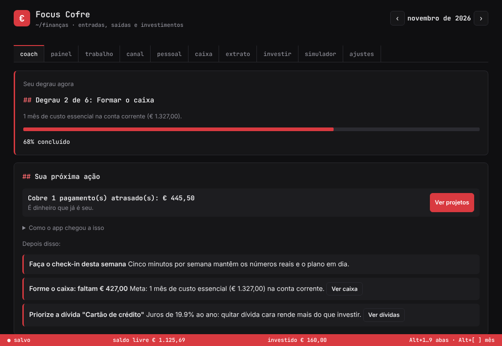
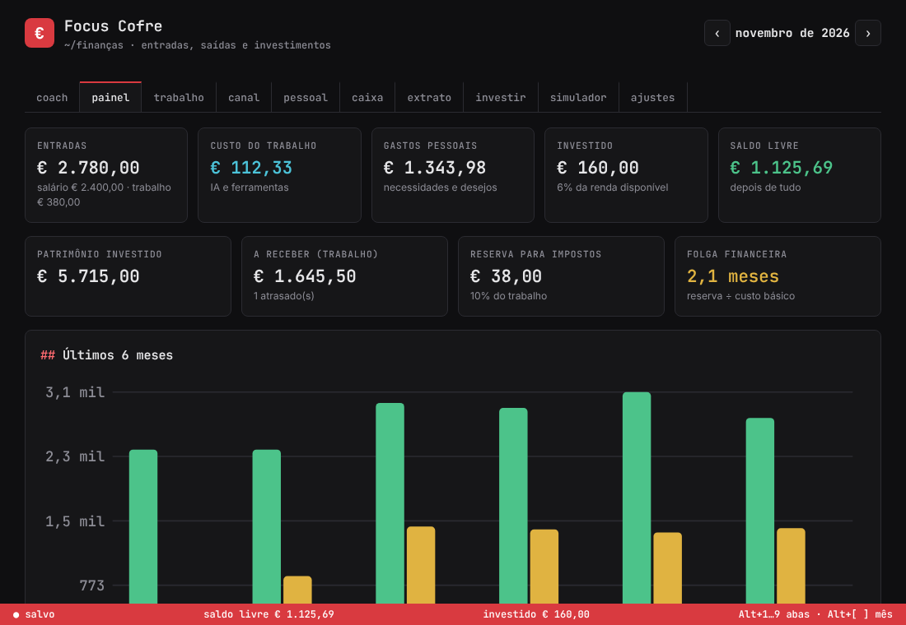
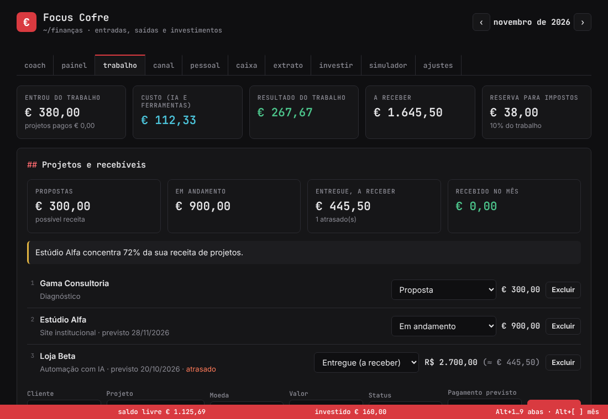
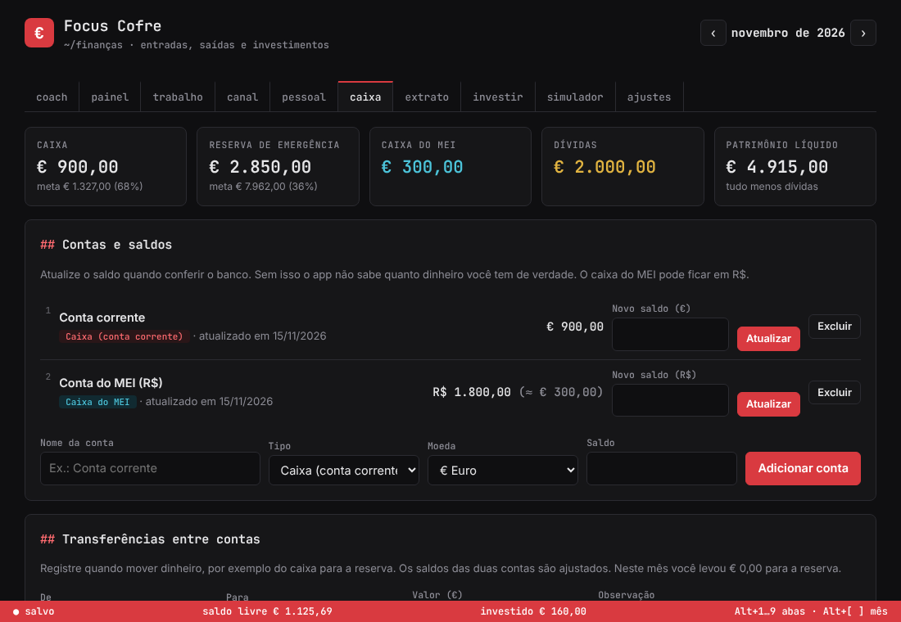

# Focus Cofre

**Coach financeiro pessoal, local-first, em euros.** Registra entradas e saídas, separa trabalho e vida pessoal,
monta um plano em degraus (caixa → dívidas → reserva → investir → renda extra) e conversa com você sobre os seus
números, sem enviar seus dados para a nuvem.



> Projeto pessoal construído do zero: engenharia de software, modelagem de domínio financeiro, segurança local e
> integração de LLM com ferramentas. Código, decisões e limites estão documentados em [`docs/`](docs/).
> **English summary at the end of this file.**

## Por que existe

Aplicativos de finanças costumam ser planilhas bonitas: mostram o passado e deixam a decisão para você.
O Focus Cofre tenta responder a pergunta que importa: **"o que eu faço com o dinheiro este mês?"**.

O perfil de uso que guiou o design: pessoa empregada na Espanha (renda em euros), com renda extra de um MEI no Brasil
(em reais), uma dívida a quitar, uma reserva de emergência a formar e um canal de conteúdo ainda não monetizado.
Isso gerou requisitos reais, como várias moedas, impostos de dois países e renda irregular.

## O que ele faz

| Área | O que tem |
|---|---|
| **Coach** | Diagnóstico inicial, 6 degraus com progresso, próxima ação com explicação ("como o app chegou a isso"), plano do mês ("pague-se primeiro"), calendário de 14 dias, detecção de hábitos e anomalias, nota de saúde financeira, check-in semanal, evolução do patrimônio, previsão de caixa de 6 meses, prazos, simulador "e se…?" |
| **Coach com IA** | Conversa com o Claude. A IA usa **10 ferramentas locais** (cálculos do app) em vez de inventar números. Só saem totais e médias, nunca nomes ou descrições |
| **Trabalho** | Projetos e recebíveis (propostas, atrasos, concentração de clientes), preço mínimo da hora, retorno das ferramentas de IA, reserva para impostos, teto anual do MEI |
| **Canal** | YouTube, Twitch e outras: caminho até a monetização com **data estimada por regressão linear**, métricas semanais, receitas, simulador, checklist |
| **Caixa** | Contas com saldo estimado, transferências, dívidas (método avalanche), metas, restauração de backup |
| **Extrato** | Lançamentos editáveis e recorrentes, **importação de CSV bancário** (valor único ou débito/crédito, moeda, conta, coluna de saldo, categoria sugerida) |
| **Investir** | Plano de aporte por perfil, carteira, produtos e imposto sobre ganhos para a Espanha |

|  |  |
|---|---|
|  |  |
|  |  |

## Destaques técnicos

- **Local-first.** Os dados ficam num SQLite no computador do usuário. Sem conta, sem servidor, sem telemetria.
- **Dinheiro em centavos inteiros** no banco, múltiplas moedas com **câmbio gravado por transação** (mudar o câmbio hoje não reescreve o passado).
- **Motor financeiro testável.** Regras de negócio puras, cobertas por testes de comportamento. Detalhes em [`docs/MOTOR-FINANCEIRO.md`](docs/MOTOR-FINANCEIRO.md).
- **LLM com fronteira de privacidade.** A chave da API fica só no servidor local (o navegador nunca a vê). A IA responde com **tool use**: cada número vem de uma ferramenta executada no navegador. Chamada pelo SDK oficial, com blocos de raciocínio devolvidos intactos.
- **Segurança de servidor local.** Escuta só em `127.0.0.1`, token por sessão, validação do cabeçalho `Host`, proteção contra *path traversal* e validação estrita de entrada. Ver [`docs/SEGURANCA-E-PRIVACIDADE.md`](docs/SEGURANCA-E-PRIVACIDADE.md).
- **Banco com migrações e restauração.** Esquema versionado (v7), migrações automáticas, backup diário e restauração com cópia de segurança.
- **Sem framework e sem etapa de build no front-end:** JavaScript em módulos simples, fáceis de ler.
- **Distribuição para Windows sem Windows.** Um script monta uma pasta portátil (launcher em Go + Python embutido + bibliotecas nativas) a partir do Linux. Ver [`docs/DECISOES.md`](docs/DECISOES.md).
- **Estratégia de testes em camadas:** unidade, integração com um **servidor falso da API do Claude**, e ponta a ponta com navegador real.

## Como rodar

### Windows (versão portátil)
1. Baixe `FocusCofre-Windows.zip` (gerado pelo workflow `portatil-windows` ou por `python tools/montar_windows.py`).
2. Extraia a pasta inteira e abra `FocusCofre.exe`. Usa o Edge ou Chrome já instalados.
3. O Windows pode exibir o aviso do SmartScreen porque o programa não tem assinatura digital paga.

### Desenvolvimento (qualquer sistema)
```bash
pip install -r requirements.txt     # anthropic (e pywebview/pyinstaller para empacotar)
python app.py --browser             # abre no navegador; use --janela para janela do Edge/Chrome
```
Dados: `%APPDATA%\FocusCofre\cofre.db` no Windows, `~/.local/share/focuscofre/cofre.db` no Linux.

### Gerar o executável
- **Portátil (recomendado, funciona a partir do Linux):** `python tools/montar_windows.py` (precisa de Go, curl e pip).
- **Arquivo único com PyInstaller (no Windows):** `build.bat`.

### Coach com IA (opcional)
Em **ajustes**, cole a chave da API da Anthropic e escolha o modelo. Sem chave, tudo continua funcionando por regras locais.

## Testes

```bash
python -m unittest discover -s tests            # 26 testes: banco, migrações, API, restauração, ponte com a IA
node tests/logic.test.js                        # 32 verificações da lógica financeira (requer playwright)
python tests/e2e/rodar_llm.py                   # conversa com o coach, de ponta a ponta
python tests/e2e/rodar_llm.py tests/e2e/fluxos.js   # extrato, canal, moedas e backup, de ponta a ponta
```
Mais em [`docs/TESTES.md`](docs/TESTES.md).

## Estrutura

```
app.py            servidor local (127.0.0.1) + janela + ciclo de vida
db.py             SQLite: validação, migrações, backup e restauração
llm.py            ponte com a API do Claude (SDK oficial)
web/              interface (HTML + CSS + JavaScript em módulos)
tools/            bundle.py (arquivo único) e montar_windows.py (pacote portátil)
windows/          launcher em Go
tests/            testes em Python, Node e ponta a ponta
docs/             arquitetura, motor financeiro, decisões, segurança e testes
```
~2.700 linhas de código de produção (Python ~900, JavaScript ~1.700) e ~650 linhas de testes.

## Documentação

- [Arquitetura](docs/ARQUITETURA.md) · [Motor financeiro](docs/MOTOR-FINANCEIRO.md) · [Decisões de projeto](docs/DECISOES.md)
- [Segurança e privacidade](docs/SEGURANCA-E-PRIVACIDADE.md) · [Testes](docs/TESTES.md) · [Changelog](CHANGELOG.md) · [Como contribuir](CONTRIBUTING.md)

## Status e limites (sem enfeite)

- Testado: unidade, integração, ponta a ponta no navegador (Chromium) e nas larguras de celular.
- **Não testado ainda:** execução real do pacote no Windows e chamada real à API do Claude (testada contra um servidor falso que confere o formato exato da requisição).
- O app **calcula e organiza**; não é consultoria financeira nem fiscal. Alíquotas e requisitos de plataformas mudam e estão marcados como referência.
- Premissas do perfil de uso (Espanha, MEI no Brasil) são configuráveis em **ajustes**, mas alguns textos ainda assumem esse perfil.

## Licença

[MIT](LICENSE).

---

## English summary

**Focus Cofre** is a local-first personal finance *coach* (EUR-based, multi-currency). It tracks income and expenses,
separates work from personal money, builds a step-by-step plan (cash buffer → debt → emergency fund → investing →
extra income) and answers questions through an LLM that **calls local tools instead of making up numbers**.

**Highlights:** SQLite with versioned migrations and restore; money stored as integer cents with per-transaction FX
rates; testable financial engine (avalanche debt payoff, cash forecast, anomaly detection, linear-regression ETA to
platform monetization thresholds); bank-CSV importer (single or debit/credit columns); loopback-only server with
per-session token, Host validation and path-traversal protection; LLM bridge using the official `anthropic` SDK with
a privacy boundary (the API key never reaches the browser, only aggregates are sent); layered tests (unit, integration
against a fake Claude API server, browser end-to-end); and a **Windows portable build cross-compiled from Linux**
(Go launcher + embedded Python + Windows wheels).

**Stack:** Python 3.12 (stdlib HTTP server, SQLite), vanilla JavaScript (no framework or build step), Go (launcher),
Anthropic Python SDK, Playwright (tests), GitHub Actions.

**Status:** unit, integration and browser end-to-end tests pass. The Windows package and the live Claude API call
have not been run on real Windows / with a real key yet. Not financial or tax advice.
