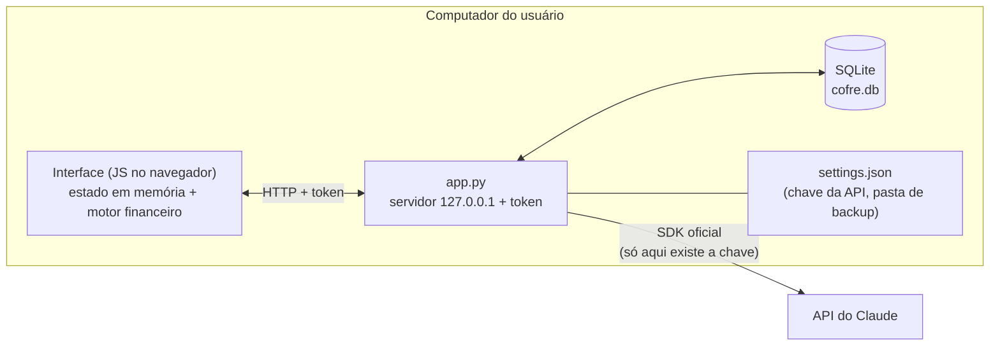
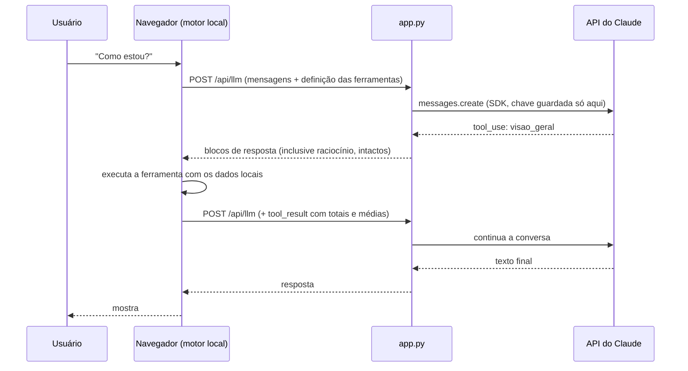

# Arquitetura

## Visão geral

O Focus Cofre é uma aplicação **local-first**: um servidor HTTP mínimo escuta só em `127.0.0.1`, serve a interface
(HTML, CSS e JavaScript estáticos) e grava o estado num SQLite. O navegador (ou uma janela do Edge/Chrome em modo
aplicativo) é só a tela.

**Por que o motor financeiro roda no navegador?** Porque a interface precisa recalcular tudo a cada clique e porque
as ferramentas da IA executam ali, ao lado dos dados. O servidor valida e persiste; não calcula.

## Componentes

| Arquivo | Responsabilidade |
|---|---|
| `app.py` | Servidor HTTP, autenticação por token, ciclo de vida (abre janela, encerra ao fechar), instância única |
| `db.py` | Esquema, migrações, validação de entrada, leitura/gravação do estado, backup e restauração, configurações |
| `llm.py` | Validação do pedido e chamada ao SDK `anthropic`; mapeia erros da API para mensagens claras |
| `web/js/*.js` | Estado, motor financeiro, telas e eventos (carregados em ordem, veja `web/index.html`) |
| `tools/` | `bundle.py` (arquivo único para publicar) e `montar_windows.py` (pacote portátil) |
| `windows/launcher` | Launcher em Go sem console |

### Módulos de interface (`web/js`)

| Módulo | Conteúdo |
|---|---|
| `01-base` | Categorias, estado, `norm()` (valores padrão), dados de exemplo, persistência (API ou `localStorage`) |
| `02-calculos` | Moedas, `calc(mês)`, saldos, essencial médio, dívidas, degraus, saúde, ações, previsão |
| `03-graficos-dicas` | Gráficos em SVG e recomendações |
| `04`…`07` | Telas: painel, extrato e importação, trabalho e pessoal, investir e simulador |
| `08-coach` | Tela do coach, seções dobráveis, vencimentos, patrimônio |
| `09-caixa-ajustes` | Contas, dívidas, backup, ajustes |
| `09b-canal` | Canal de conteúdo: requisitos, previsão de data, receitas |
| `09c-cerebro` | Anomalias, tendências, cenários "e se" |
| `09d-llm` | Ferramentas, laço de conversa com a IA, configurações |
| `10-eventos` / `11-boot` | Eventos, renderização e inicialização |

## Modelo de dados

O estado é um objeto único (`renda`, `lanc`, `subs`, `projetos`, `contas`, `dividas`, `carteira`, `canais`, …).
O navegador envia o estado inteiro (`PUT /api/state`, com atraso de 150 ms) e o servidor o **valida e grava numa
transação** (tudo ou nada). É simples e seguro para um app de um usuário.

Tabelas: `renda`, `lanc`, `subs`, `metas`, `carteira`, `projetos`, `limites`, `contas`, `movs`, `dividas`,
`checkins`, `canais`, `metricas`, `receitas_canal`, `meta` (configuração em JSON). Esquema na versão **7**.

- Valores monetários em **centavos** (`INTEGER`). Câmbio guardado **por transação**.
- Migrações idempotentes em `db.migrate()` (por exemplo, recria `projetos` para aceitar o status `perdido`).
- Integridade: `PRAGMA integrity_check` antes de restaurar um backup.

## API local

| Método e rota | Auth | Função |
|---|---|---|
| `GET /`, `/js/*`, `/style.css` | não | Interface (o token é injetado no HTML) |
| `GET /api/health` | não | Verifica se é um Focus Cofre (usado para instância única) |
| `GET`/`PUT /api/state` | token | Ler e gravar o estado |
| `GET`/`PUT /api/settings` | token | Configurações (a chave da API **nunca** volta na resposta) |
| `GET /api/backups`, `POST /api/restore` | token | Listar e restaurar backups |
| `POST /api/llm` | token | Uma volta de conversa com o Claude (o navegador executa as ferramentas) |
| `GET /api/ping`, `POST /api/bye` | token na URL | Sinal de vida: encerra o app depois que a janela fecha |

## Conversa com a IA (tool use)

As 10 ferramentas devolvem só agregados (totais, médias, prazos). O laço tem no máximo 8 voltas por pergunta.

## Ciclo de vida da janela

O navegador envia `ping` a cada 15 s e `bye` ao fechar a página (`sendBeacon`). O servidor espera 60 s depois do `bye`
(para aguentar recarregar a página) e, se não houver novo `ping`, encerra. Há também um limite de 5 min sem sinal e
proteção contra suspensão do computador. Uma segunda abertura reaproveita a instância ativa (`instancia.json`).
