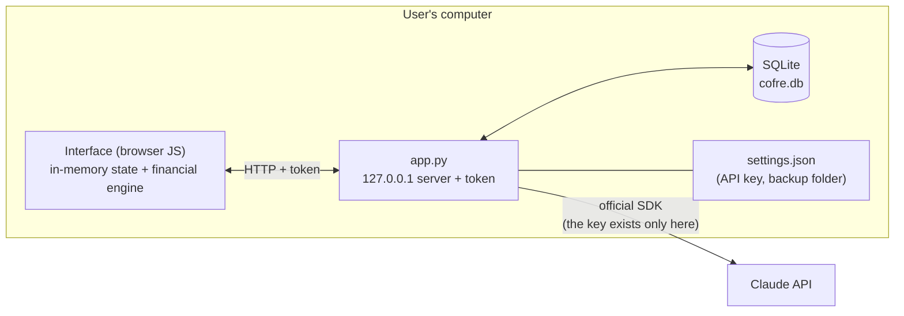
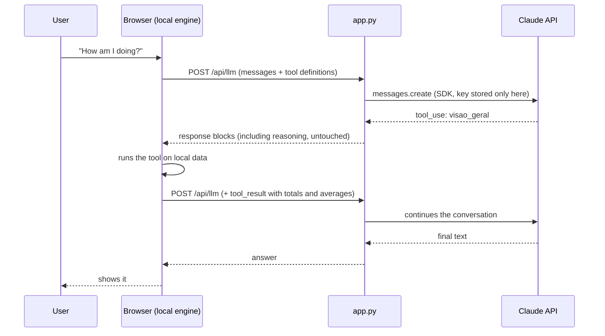

# Architecture

🌐 **English** · [Português](../pt-BR/ARQUITETURA.md) · [Español](../es/ARQUITECTURA.md) · [← README](../../README.md)

## Overview

Focus Cofre is a **local-first** application: a minimal HTTP server listens on `127.0.0.1` only, serves the interface
(static HTML, CSS and JavaScript) and stores the state in SQLite. The browser (or an Edge/Chrome window in app mode)
is just the screen.

**Why does the financial engine run in the browser?** Because the interface must recompute everything on each click
and because the AI tools run there, next to the data. The server validates and persists; it does not calculate.

## Components

| File | Responsibility |
|---|---|
| `app.py` | HTTP server, token authentication, lifecycle (opens the window, exits when it closes), single instance |
| `db.py` | Schema, migrations, input validation, reading/writing the state, backup and restore, settings |
| `llm.py` | Validates the request and calls the `anthropic` SDK; maps API errors to clear messages |
| `web/js/*.js` | State, financial engine, screens and events (loaded in order, see `web/index.html`) |
| `tools/` | `bundle.py` (single file to publish) and `montar_windows.py` (portable package) |
| `windows/launcher` | Console-less Go launcher |

### Interface modules (`web/js`)

| Module | Content |
|---|---|
| `01-base` | Categories, state, `norm()` (defaults), sample data, persistence (API or `localStorage`) |
| `02-calculos` | Currencies, `calc(month)`, balances, average essential cost, debts, steps, health, actions, forecast |
| `03-graficos-dicas` | SVG charts and recommendations |
| `04`…`07` | Screens: dashboard, statement and import, work and personal, invest and simulator |
| `08-coach` | Coach screen, collapsible sections, due dates, net worth |
| `09-caixa-ajustes` | Accounts, debts, backup, settings |
| `09b-canal` | Content channel: requirements, date forecast, revenue |
| `09c-cerebro` | Anomalies, trends, "what if" scenarios |
| `09d-llm` | Tools, AI conversation loop, settings |
| `10-eventos` / `11-boot` | Events, rendering and start-up |

## Data model

The state is a single object (`renda`, `lanc`, `subs`, `projetos`, `contas`, `dividas`, `carteira`, `canais`, …).
The browser sends the whole state (`PUT /api/state`, debounced by 150 ms) and the server **validates it and writes it
in one transaction** (all or nothing). It is simple and safe for a single-user app.

Tables: `renda`, `lanc`, `subs`, `metas`, `carteira`, `projetos`, `limites`, `contas`, `movs`, `dividas`, `checkins`,
`canais`, `metricas`, `receitas_canal`, `meta` (configuration as JSON). Schema version **7**.

- Monetary values in **cents** (`INTEGER`). The FX rate is stored **per transaction**.
- Idempotent migrations in `db.migrate()` (for example, it rebuilds `projetos` to accept the `perdido` status).
- Integrity: `PRAGMA integrity_check` before restoring a backup.

## Local API

| Method and route | Auth | Purpose |
|---|---|---|
| `GET /`, `/js/*`, `/style.css` | no | Interface (the token is injected into the HTML) |
| `GET /api/health` | no | Checks that it is a Focus Cofre (used for single instance) |
| `GET`/`PUT /api/state` | token | Read and write the state |
| `GET`/`PUT /api/settings` | token | Settings (the API key is **never** returned) |
| `GET /api/backups`, `POST /api/restore` | token | List and restore backups |
| `POST /api/llm` | token | One turn of conversation with Claude (the browser runs the tools) |
| `GET /api/ping`, `POST /api/bye` | token in URL | Liveness signal: the app exits after the window closes |

## AI conversation (tool use)

The 10 tools return aggregates only (totals, averages, deadlines). The loop is capped at 8 turns per question.

## Window lifecycle

The browser sends a `ping` every 15 s and a `bye` when the page closes (`sendBeacon`). The server waits 60 s after
`bye` (so reloading the page is fine) and exits if there is no new `ping`. There is also a 5-minute limit without a
signal and protection against computer suspend. A second launch reuses the running instance (`instancia.json`).
