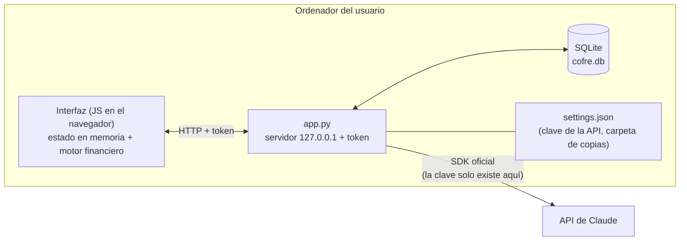
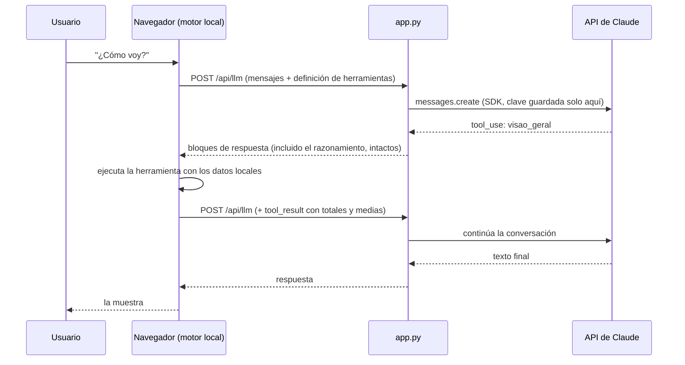

# Arquitectura

🌐 [English](../en/ARCHITECTURE.md) · [Português](../pt-BR/ARQUITETURA.md) · **Español** · [← README](../../README.es.md)

## Visión general

Focus Cofre es una aplicación **local-first**: un servidor HTTP mínimo escucha solo en `127.0.0.1`, sirve la interfaz
(HTML, CSS y JavaScript estáticos) y guarda el estado en SQLite. El navegador (o una ventana de Edge/Chrome en modo
aplicación) es solo la pantalla.

**¿Por qué el motor financiero se ejecuta en el navegador?** Porque la interfaz debe recalcular todo en cada clic y
porque las herramientas de la IA se ejecutan allí, junto a los datos. El servidor valida y persiste; no calcula.

## Componentes

| Archivo | Responsabilidad |
|---|---|
| `app.py` | Servidor HTTP, autenticación por token, ciclo de vida (abre la ventana, termina al cerrarla), instancia única |
| `db.py` | Esquema, migraciones, validación de entrada, lectura/escritura del estado, copia de seguridad y restauración, ajustes |
| `llm.py` | Valida la petición y llama al SDK `anthropic`; traduce los errores de la API a mensajes claros |
| `web/js/*.js` | Estado, motor financiero, pantallas y eventos (se cargan en orden, véase `web/index.html`) |
| `tools/` | `bundle.py` (archivo único para publicar) y `montar_windows.py` (paquete portátil) |
| `windows/launcher` | Lanzador en Go sin consola |

### Módulos de la interfaz (`web/js`)

| Módulo | Contenido |
|---|---|
| `01-base` | Categorías, estado, `norm()` (valores por defecto), datos de ejemplo, persistencia (API o `localStorage`) |
| `02-calculos` | Monedas, `calc(mes)`, saldos, coste esencial medio, deudas, pasos, salud, acciones, previsión |
| `03-graficos-dicas` | Gráficos SVG y recomendaciones |
| `04`…`07` | Pantallas: panel, extracto e importación, trabajo y personal, invertir y simulador |
| `08-coach` | Pantalla del coach, secciones plegables, vencimientos, patrimonio |
| `09-caixa-ajustes` | Cuentas, deudas, copia de seguridad, ajustes |
| `09b-canal` | Canal de contenido: requisitos, previsión de fecha, ingresos |
| `09c-cerebro` | Anomalías, tendencias, escenarios «¿y si?» |
| `09d-llm` | Herramientas, bucle de conversación con la IA, ajustes |
| `10-eventos` / `11-boot` | Eventos, renderizado e inicio |

## Modelo de datos

El estado es un único objeto (`renda`, `lanc`, `subs`, `projetos`, `contas`, `dividas`, `carteira`, `canais`, …).
El navegador envía el estado completo (`PUT /api/state`, con retardo de 150 ms) y el servidor lo **valida y lo escribe
en una sola transacción** (todo o nada). Es sencillo y seguro para una app de un solo usuario.

Tablas: `renda`, `lanc`, `subs`, `metas`, `carteira`, `projetos`, `limites`, `contas`, `movs`, `dividas`, `checkins`,
`canais`, `metricas`, `receitas_canal`, `meta` (configuración en JSON). Esquema en la versión **7**.

- Valores monetarios en **céntimos** (`INTEGER`). El tipo de cambio se guarda **por transacción**.
- Migraciones idempotentes en `db.migrate()` (por ejemplo, reconstruye `projetos` para aceptar el estado `perdido`).
- Integridad: `PRAGMA integrity_check` antes de restaurar una copia.

## API local

| Método y ruta | Auth | Función |
|---|---|---|
| `GET /`, `/js/*`, `/style.css` | no | Interfaz (el token se inyecta en el HTML) |
| `GET /api/health` | no | Comprueba que es un Focus Cofre (se usa para la instancia única) |
| `GET`/`PUT /api/state` | token | Leer y escribir el estado |
| `GET`/`PUT /api/settings` | token | Ajustes (la clave de la API **nunca** se devuelve) |
| `GET /api/backups`, `POST /api/restore` | token | Listar y restaurar copias de seguridad |
| `POST /api/llm` | token | Un turno de conversación con Claude (el navegador ejecuta las herramientas) |
| `GET /api/ping`, `POST /api/bye` | token en la URL | Señal de vida: la app termina cuando se cierra la ventana |

## Conversación con la IA (uso de herramientas)

Las 10 herramientas devuelven solo agregados (totales, medias, plazos). El bucle tiene un máximo de 8 vueltas por pregunta.

## Ciclo de vida de la ventana

El navegador envía un `ping` cada 15 s y un `bye` al cerrar la página (`sendBeacon`). El servidor espera 60 s tras el
`bye` (para aguantar una recarga) y, si no hay un nuevo `ping`, termina. También hay un límite de 5 min sin señal y
protección frente a la suspensión del ordenador. Una segunda apertura reutiliza la instancia activa (`instancia.json`).
